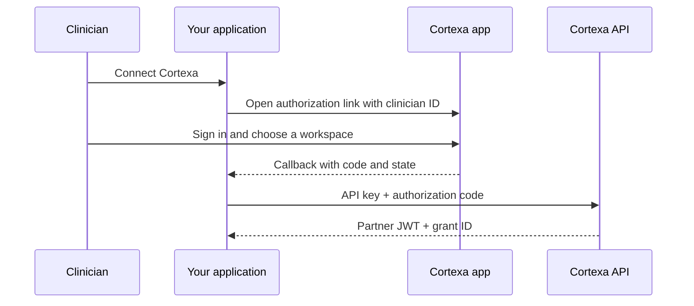

A typical integration connects the clinician once, then creates a session for
each consultation.

## Connect a clinician

Save the returned `grant_id` for the clinician and workspace. Your backend uses it
with the API key to renew access tokens. The clinician only needs to reconnect
when authorization is no longer valid. See [Authentication](/authentication).

## Run a consultation

<Steps>
  <Step title="Open the patient and session">
    Send your patient and encounter IDs to the [session workflow](/session-workflow).
    It creates or resumes the consultation and returns Cortexa IDs for later requests.
  </Step>
  <Step title="Add clinical input">
    Submit transcript text or audio and add relevant [history and reports](/context).
    Wait for transcription and any required attachments to finish processing.
  </Step>
  <Step title="Generate the note">
    Choose a [template](/templates) and request a [consult note](/notes).
    Display incoming `output.delta` text. The final `output.ready` event contains
    the saved document.
  </Step>
  <Step title="Review and save">
    Let the clinician review the draft. [Save edits](/documents#save-an-edit) in
    Cortexa, then write the reviewed result through your EHR API or an
    [approved connector call](/connectors).
  </Step>
</Steps>

## Choose an input path

| Input | Use | Ready when |
| --- | --- | --- |
| Transcript text | [Transcript segments](/transcripts) | The final batch is submitted |
| Complete recording | [Recording uploads](/recordings) | The transcription job succeeds |
| Audio recorded during the consultation | [Segmented transcription](/segmented-transcription) | All chunks are uploaded and finish succeeds |

The [Widget](/widget) provides recording and review UI. Use the
[JavaScript SDK](/javascript-sdk) to build your own interface.

## Keep the IDs you will need

| ID | Source | Use |
| --- | --- | --- |
| `grant_id` | Token response | Renew the clinician's token |
| Patient `id` | Patient or workflow response | Link consultations to the patient |
| Session `id` | Session or workflow response | Add inputs and retrieve outputs |
| `document_ids` | Generation stream or receipt | Retrieve and edit outputs |
| `job_id` / `job_ids` | Processing receipt or stream | Check background work |
| `current_version` | Saved document | Submit edits as `base_version` |

Use the same grant throughout the consultation. A different grant cannot access
its patients or sessions, even under the same application.

<Card title="Generate your first note" icon="arrow-right" href="/quickstart">
  Try the complete flow with a synthetic transcript and cURL.
</Card>
