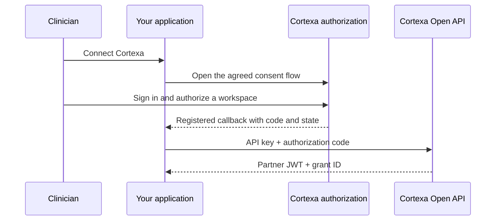

Your application owns the clinician's workflow. Cortexa processes the clinical
material you submit and returns notes, documents, and answers. This guide follows
one clinician seeing one synthetic patient, Alex Example.

## Who does what

| Participant | Responsibility |
| --- | --- |
| Clinician | Authorizes access to a Cortexa workspace, conducts the consultation, and reviews the output |
| Your frontend | Selects the patient, captures audio if needed, and displays progress and editable drafts |
| Your backend | Keeps the API key, exchanges tokens, calls the API, and saves reviewed output to your EHR |
| Cortexa | Checks authorization, processes audio and context, generates output, and exposes results |

The API does not supply an embedded recording interface or write directly into
your EHR. Your application implements those parts of the workflow.

## Connect a clinician

The **grant** records which application may act for which clinician and workspace.
Keep its ID alongside your clinician/workspace mapping. When the JWT expires,
your backend can exchange the API key and the existing grant ID for another JWT.
The clinician does not need to repeat consent for every consultation while the
grant remains valid.

See [Authentication](/authentication) for the three credential types and the
exact exchange. Coordinate the consent entry point during [sandbox onboarding](/sandbox).

## Run a consultation

<Steps>
  <Step title="Identify the patient">
    Create Alex Example with an `external_patient_id` from your EHR. Save the
    returned Cortexa patient ID. Repeating the same external ID within the grant
    returns the existing patient; use PATCH when its details change.
  </Step>
  <Step title="Create the session">
    A session represents this consultation. Give it your encounter's
    `external_session_id`, attach the Cortexa patient ID, and add relevant
    history to `background_context` or upload context documents.
  </Step>
  <Step title="Provide the conversation">
    Submit an existing transcript, upload a complete audio recording, or send
    independently decodable audio segments during the consultation. Finish
    transcription before generating the final note.
  </Step>
  <Step title="Request the note">
    Select an available template and request a consult note. A `200` streaming
    response starts with document and job IDs, then delivers generated text.
  </Step>
  <Step title="Display text and receive the result">
    Append each `output.delta` to the draft. The final `output.ready` contains
    the saved document, including `rendered_text`, `content`, and its version.
    See [Streaming](/streaming) for reconnects and background JSON mode.
  </Step>
  <Step title="Review and save">
    Show the draft to the clinician. Save edits to Cortexa using the document's
    current version if you need both systems to retain the reviewed text. Then
    write the reviewed result to the correct encounter through your EHR's API.
  </Step>
</Steps>

## Choose an input path

| You already have… | Use | Continue when… |
| --- | --- | --- |
| Transcript text | [Transcript segments](/transcripts) | The final batch has been submitted |
| A complete recording | [Recording uploads](/recordings) | The transcription job succeeds |
| Audio arriving during a consultation | [Segmented transcription](/segmented-transcription) | All segments are uploaded and finish succeeds |

Context files supplement these inputs. Wait for their extraction and indexing
before requesting output that should use them.

## Keep the IDs you will need

| ID | What it identifies | Where you get it |
| --- | --- | --- |
| `grant_id` | Clinician/workspace authorization | Token response |
| Patient `id` | Patient within that grant | Patient creation or lookup |
| Session `id` | Consultation within that grant | Session creation or lookup |
| `job_id` / `job_ids` | Background work | `generation.started` or a processing receipt |
| `document_ids` | Generated outputs | `generation.started` or a JSON generation receipt |
| `current_version` | Current editable document revision | `output.ready` or document GET |

Use the same grant throughout the workflow. A session created under a different
grant is not accessible just because both grants belong to the same application.

<Card title="Generate your first note" icon="arrow-right" href="/quickstart">
  Walk through this flow with a short synthetic transcript and cURL.
</Card>
