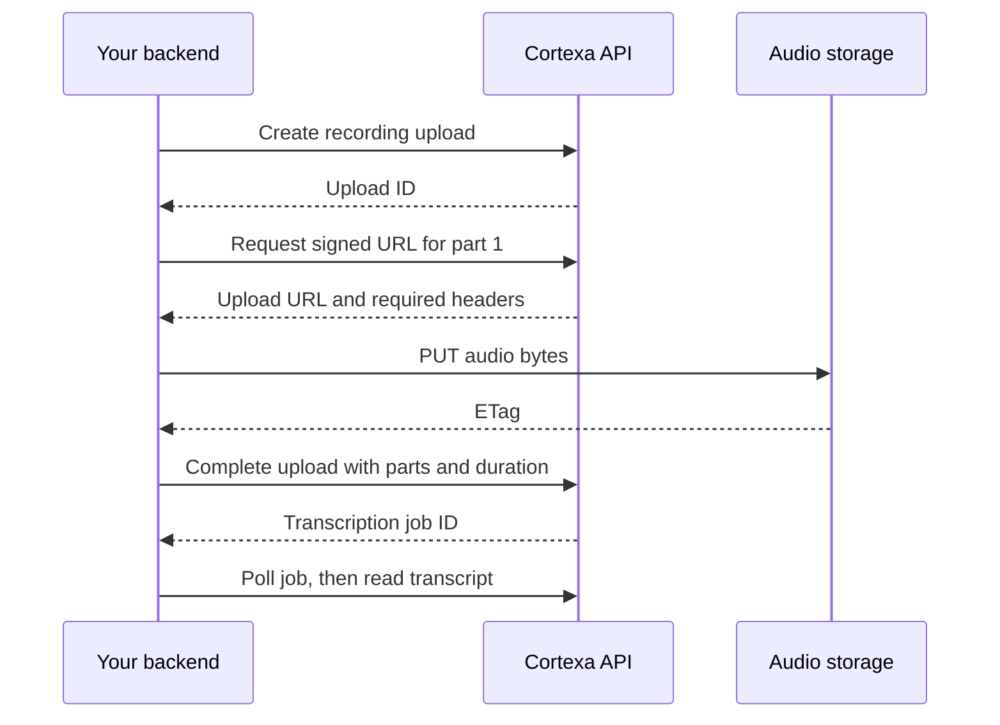

Use this workflow when you already have a complete consultation recording. For
audio arriving during the consultation, use [segmented transcription](/segmented-transcription).

You need an existing session, `scribe:write` for the upload workflow, and
`scribe:read` to poll the transcription job and retrieve its result. Use a local
synthetic audio file when testing.

## Upload sequence



## 1. Create an upload

`POST /sessions/{session_id}/recording-uploads`

```bash
curl --request POST "$CORTEXA_API_BASE/sessions/$CORTEXA_SESSION_ID/recording-uploads" \
  --header "Authorization: Bearer $CORTEXA_JWT" \
  --header 'Content-Type: application/json' \
  --header 'Idempotency-Key: visit-001-audio-upload-1' \
  --data '{"file_name":"synthetic-consultation.wav","mime_type":"audio/wav","size_bytes":4096,"part_count":1}'
```

Replace the illustrative file size with the actual number of bytes in your file.

| Field | Required | Meaning |
| --- | --- | --- |
| `file_name` | Yes | Original filename; 1–255 characters |
| `mime_type` | No | Audio MIME type; defaults to `audio/wav` |
| `size_bytes` | Yes | Total recording size in bytes, greater than zero |
| `part_count` | No | Number of parts, from 1 to 10,000; defaults to 1 |

The `201` response contains `id`, `session_id`, `status`, and `part_count`.
Save `id` as `CORTEXA_UPLOAD_ID`. This is the **upload ID**, not the recording ID
returned later on completion.

## 2. Request a URL for a part

```bash
curl --request POST "$CORTEXA_API_BASE/recording-uploads/$CORTEXA_UPLOAD_ID/upload-urls" \
  --header "Authorization: Bearer $CORTEXA_JWT" \
  --header 'Content-Type: application/json' \
  --data '{"part_number":1}'
```

The response contains `upload_url`, `expires_at`, and required `headers`.
Parts are numbered from **1**, unlike zero-based segmented transcription indices.
Signed URLs expire after 15 minutes; request another URL if necessary.

## 3. Upload the bytes

Set `CORTEXA_UPLOAD_URL` to the returned URL. Send the returned headers; for the
`audio/wav` example they contain `Content-Type: audio/wav`:

```bash
curl --fail-with-body --request PUT "$CORTEXA_UPLOAD_URL" \
  --header 'Content-Type: audio/wav' \
  --data-binary '@./synthetic-consultation.wav' \
  --dump-header ./synthetic-upload-response.headers
```

Read the storage response's `ETag` from the saved headers and retain it for the
completion request. The file with response headers is a temporary integration
artifact; keep signed URLs and credentials out of shared logs.

Send the Partner JWT only to Cortexa API endpoints. The signed storage URL carries
its own authorization, so do not add the Partner JWT to the storage PUT.

For multiple parts, request and upload each consecutive part, retaining every
part's number and ETag.

## 4. Complete the upload

`POST /recording-uploads/{upload_id}/completion`

```bash
curl --request POST "$CORTEXA_API_BASE/recording-uploads/$CORTEXA_UPLOAD_ID/completion" \
  --header "Authorization: Bearer $CORTEXA_JWT" \
  --header 'Content-Type: application/json' \
  --header 'Idempotency-Key: visit-001-audio-complete-1' \
  --data '{"parts":[{"part_number":1,"etag":"ETAG_FROM_STORAGE_RESPONSE"}],"duration_ms":30000}'
```

Replace the ETag and duration with the values for your recording. `duration_ms`
is the **whole recording's duration in milliseconds**. Include every uploaded part.

The `202` response contains the recording `id`, `status`, and a
`transcription_job_id` when processing is scheduled.

## 5. Retrieve the transcript and generate a note

Poll the returned transcription job until it succeeds, then read
`GET /sessions/{session_id}/transcript`. Submit the resulting session to
[consult-note generation](/notes).

The completion request starts the transcription workflow; you do not trigger
transcription by repeatedly fetching the transcript. The API does not expose a
single multipart `/upload-audio` endpoint for complete recordings.

## Retry an interrupted upload

Reuse the same idempotency key and body for a retried upload-creation or completion
operation. If a signed URL expires, request a fresh URL for that part. Do not call
completion until the part PUTs have succeeded and their ETags are available.

Keep upload and recording IDs separate in your application. See [Errors](/errors)
for request failures and [Jobs](/jobs) for transcription failures.
